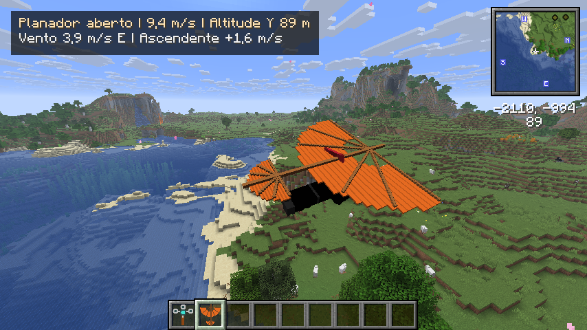
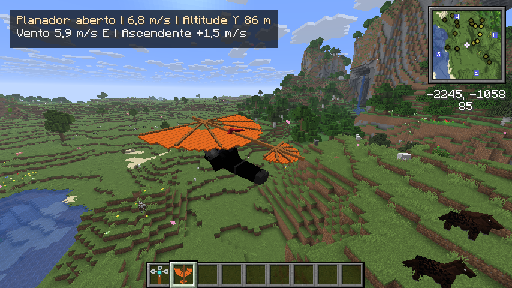
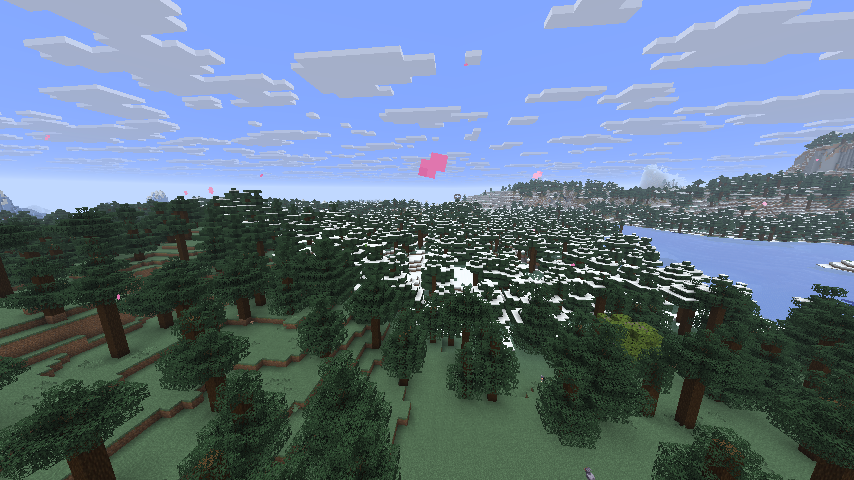

# WindCraft BR 0.6.0 — Alpha

Vento dinâmico, nuvens em movimento, Anemômetro e um Planador de Vento craftável.
Simulação controlada pelo servidor para Minecraft Java com Forge.



Captura real da versão 0.6.0 enviada pelo autor: asas em leque, pose de voo e HUD de vento.



Captura real em terceira pessoa, com velocidade, altitude Y e corrente ascendente.
A perspectiva é a escolhida pelo jogador; primeira pessoa também é suportada.



Captura enviada pelo autor, mostrando as partículas ambientais no mundo.

**[Como craftar os itens: Planador e Anemômetro](docs/CRAFTING.md)** ·
**[Testes e limitações da Alpha](VALIDATION.md)** ·
**[Sistema de voo 0.6.0](docs/GLIDER_FLIGHT_SYSTEM.md)**

## Novidades da 0.6.0

- Novo modelo com asas laranja em leque, varetas de madeira e cauda menor.
- As 16 cores de lã definem a cor do tecido e do ícone. Use quatro lãs da mesma cor.
- A/D inclinam o equipamento e produzem curvas reais, com retorno suave ao soltar.
- Vento relativo, ascendentes, arrasto e limites de velocidade preservados.
- Foco no vento e no planador: vila, monge e bisão foram retirados do código ativo;
  suas fontes permanecem em `archive/wind-society/`.

Em mundos de testes antigos que contenham monge ou bisão, use uma cópia: esses
IDs de entidade não estão registrados nesta versão. Cliente e servidor devem
usar a mesma versão, com protocolo de rede 7.

Download do mod: [windcraft-0.6.0.jar](dist/windcraft-0.6.0.jar).
Esta é uma versão Alpha; a validação completa de áudio, multiplayer e colisões
ainda está pendente. Não há turbinas ou barcos nesta versão.

Minecraft Java **26.3**, Forge **66.1.8**, Java **25**, Windows 11.
Projeto baseado no [MDK oficial](https://files.minecraftforge.net/net/minecraftforge/forge/).

## Instalar ou atualizar

1. Instale Forge **66.1.8** para Minecraft 26.3 e selecione esse perfil no Launcher.
2. Copie `dist/windcraft-0.6.0.jar` para `%APPDATA%\.minecraft\mods`, ou para a pasta
   `mods` da instância. Retire os JARs anteriores do WindCraft dessa pasta.
3. Em multiplayer, use WindCraft 0.6.0 no servidor e em todos os clientes.

O Forge 66.1.0 não atende à dependência deste projeto.
Use a mesma versão 0.6.0 nos dois lados para manter as regras de ativação consistentes.

**O balanço dos blocos de folhas foi removido**, assim como os mixins e os shaders
de terreno correspondentes. As folhas usam a geometria original do Minecraft.
As partículas ambientais transportadas pelo vento e o movimento das nuvens continuam.

## Planador de Vento

Item `windcraft:wind_glider`, disponível na aba criativa de ferramentas/utilidades.
Para testes: `/give @s windcraft:wind_glider`.

Receita de bancada, com quatro lãs da mesma cor:

```text
L B L
L G L
C G C
```

L = lã (4 da mesma cor), B = bambu (1), G = graveto (2), C = linha (2).
O tecido e o ícone acompanham a cor usada; não há mistura de cores. Itens antigos
sem cor salva continuam laranja.

Segure o planador na mão principal ou secundária e use imediatamente, sem queda mínima. No chão ele fica preparado e passa a planar ao saltar; não cria propulsão. No ar, a ativação é imediata. Mantenha altura suficiente para frear:
abrir perto do chão durante uma queda rápida ainda pode causar dano.

| Ação | Controle padrão |
|---|---|
| Ativar ou desativar o planeio | Clique direito / usar item |
| Inclinar para acelerar, perdendo mais altitude | W |
| Inclinar para reduzir a velocidade | S |
| Inclinar e curvar | A / D; solte para retornar suavemente ao nível |
| Olhar e contribuir ao pitch | Mouse; o olhar não comanda a guinada |
| Manobra curta de sustentação | Espaço, com velocidade horizontal de pelo menos 5 m/s |
| Desativar o planeio | Shift |

O mod lê as teclas **nativas reconfiguráveis** de avançar, recuar, esquerda, direita,
pular, agachar e usar item. Reatribua-as em Opções → Controles. Não registra outro
conjunto de atalhos concorrentes. Os comandos de voo só são enviados enquanto o
servidor confirmou o planeio; com menus abertos, os eixos são neutralizados.

A manobra de sustentação dura até 12 ticks e tem intervalo de 80 ticks. É preciso
soltar Espaço e apertar novamente; segurar a tecla não produz impulsos contínuos.
Ela aumenta o arrasto e usa a energia do movimento, em vez de criar propulsão.

O modelo artesanal tem haste, tecido claro, detalhes vermelhos/alaranjados e
asas simétricas. Fora do voo, o item usa o modelo compacto na mão. Em voo, uma
camada própria expande e centraliza o planador sobre os ombros, compartilhando a
transformação do tronco. As transições não modificam a física nem a hitbox.
O ícone do inventário foi redesenhado em 64×64 com transparência. Os sons de ativação, desativação e vento
são referências aos recursos nativos do jogo.
Veja [como editar o modelo no Blockbench](docs/GLIDER_MODEL.md).

## Física e equilíbrio

`GliderPhysics` calcula a velocidade do jogador relativa ao ar, sustentação
`L = 0,5 × rho × v² × S × CL` e arrasto `D = 0,5 × rho × v² × S × CD`.
Os coeficientes variam com inclinação, curva e manobra. As forças em newtons usam
massa efetiva de 90 kg e gravidade de 9,81 m/s² no modelo de planeio. A aceleração
é dividida por 400 para converter metros/segundo² em blocos/tick².

Em ar parado, o planador perde altitude e converte parte da queda em avanço.
Vento favorável aumenta a velocidade em relação ao solo; vento contrário a reduz
sem uma penalização fixa artificial à sustentação. Vento lateral causa deriva.
Turbulência cresce acima de 12 m/s. A velocidade horizontal padrão é limitada a
22 m/s, e há limites de aceleração, subida e descida para evitar divergências.
Não há sustentação sem velocidade relativa do ar.

Correntes suficientemente fortes permitem subir. A implementação inicial combina
calor do bioma durante o dia, redução pela chuva, encostas expostas ao vento e
lava até oito blocos abaixo. Um cache por células de 16³ tem validade de 40 ticks,
até 1024 entradas por dimensão e amostras fixas; não varre o mundo nem carrega
chunks. A intensidade diminui longe do solo. É uma aproximação ambiental,
não uma simulação de fluidos. Não há editor de regiões térmicas manuais nesta versão.

Após sair do chão, o planador fecha ao pousar, entrar em água/lava, montar, escalar, iniciar
elytra/voo criativo ou trocar o item usado. Morte, desconexão e troca de dimensão
descartam o estado. Pousos estabilizados e lentos são suaves; abertura tardia,
queda rápida e colisões perigosas mantêm consequências. Colisões horizontais
fortes podem causar dano ao jogador e consumir quatro pontos de durabilidade.

Durabilidade padrão: 256. Abrir consome um ponto; o voo consome um ponto a cada
40 ticks, ou a cada 20 ticks em vento de pelo menos 14 m/s. Há pequeno consumo
de fome. O item quebra ao esgotar a durabilidade. Criativo segue as regras nativas
de material/durabilidade. O planador não permite decolar do chão nem fornece
propulsão, e não substitui a velocidade e a capacidade de impulso da elytra.

## Configurações

Gameplay por mundo: `<mundo>/serverconfig/windcraft-glider-server.toml`.
Edite com o servidor fechado.

| Chave | Padrão | Significado |
|---|---|---|
| `maxSpeed` | 1.1 | Máximo horizontal em blocos/tick |
| `airDensity` | 1.225 | Densidade efetiva do ar |
| `wingArea` | 12.0 | Área efetiva da asa |
| `lift` | 1.0 | Multiplicador de sustentação |
| `drag` | 0.08 | Coeficiente básico de arrasto |
| `windInfluence` | 0.35 | Escala do vento horizontal |
| `controlSensitivity` | 1.0 | Sensibilidade de curvas |
| `turbulence` | 1.0 | Multiplicador de turbulência |
| `durability` | 256 | Durabilidade máxima dos planadores |
| `durabilityTicks` | 40 | Intervalo de desgaste em vento normal |
| `thermals` | true | Ativa correntes ascendentes |
| `thermalStrength` | 8.0 | Máximo do vento vertical em m/s |

Alterações de durabilidade são aplicadas aos planadores nos inventários do servidor;
ao reduzir o máximo, o dano existente é limitado ao novo máximo menos um.
Os parâmetros físicos são enviados pelo servidor aos clientes durante o planeio.

Preferências locais: `config/windcraft-client.toml`.

| Chave | Padrão | Significado |
|---|---|---|
| `gliderHud` | true | HUD compacta com estado, velocidade, altura, vento e corrente |
| `gliderWindSound` | true | Som contínuo de vento durante o voo |
| `gliderWindVolume` | 0.65 | Volume do vento, de 0 a 1; também respeita o volume de jogadores |
| `gliderBodyPose` | true | Pose horizontal e camada dedicada do planador |
| `gliderTransitions` | true | Entrada/saída suaves, em aproximadamente dez ticks |
| `gliderHudScale` | 1.0 | Escala adicional da HUD, de 0.5 a 2 |
| `gliderHudX` / `gliderHudY` | 8 / 8 | Margens/posição da HUD em unidades da interface |
| `animateClouds` | true | Deslocamento das nuvens pelo vento atmosférico |
| `cloudSpeedScale` | 0.25 | Escala visual da velocidade das nuvens |

A perspectiva e o FOV permanecem os escolhidos no jogo, inclusive primeira pessoa. F5 continua funcionando durante o voo. O mod não move nem gira a câmera; o olhar do mouse orienta a física, com curvas graduais e deriva pelo vento. As antigas opções gliderCamera* não são usadas. Morte, desconexão e troca de dimensão limpam os efeitos e interrompem o áudio.

A HUD usa números em português, largura medida pela fonte e painel ajustado à
resolução/escala da interface. **Altitude Y** é a coordenada vertical do mundo;
o valor antigo de altura sobre o terreno não é mostrado nesse campo. A corrente
vertical inclui sinal e rótulo ascendente/descendente. F1 oculta a HUD; F3 também
a suprime para não sobrepor o painel de depuração. Para outros mods, ajuste X/Y:
não existe detecção universal da área ocupada por suas interfaces.

Configuração do vento: `<mundo>/serverconfig/windcraft-server.toml`, com
`baseSpeed`, `updateTicks` e `particles`. Os overrides dos comandos continuam em
`windcraft-<dimensão>.properties` dentro da mesma pasta.

## Instrumentos, comandos e depuração

O anemômetro continua disponível por receita ` I ` / `ICI` / ` S `:
I = ferro, C = bússola, S = graveto. Use para ler velocidade, direção e intensidade.

| Comando | Efeito |
|---|---|
| `/wind info` | Vento local |
| `/wind debug` | Diagnóstico de vento vertical, rajadas, turbulência e cache; alterna partículas das correntes para o jogador |
| `/wind set speed <0..60>` | Fixa velocidade antes da redução por abrigo |
| `/wind set direction <0..360>` | Fixa direção de transporte do ar |
| `/wind reset` | Retoma evolução automática |

Debug e alterações exigem permissão de mestre de jogo. As partículas de depuração
só aparecem onde há corrente ascendente. Use `/wind debug` novamente para desligar.
0° = norte (-Z), 90° = leste (+X), 180° = sul (+Z), 270° = oeste (-X).
Nuvens precisam estar habilitadas nas opções de vídeo. Nether e End não têm
vento/térmicas nesta versão; o planador ainda pode planar em ar parado.

## Rede e arquitetura

- `glider/GliderPhysics`: forças e conversão de unidades, sem dependências de Minecraft.
- `glider/GliderState`: ativação/desativação imediata do planeio.
- `glider/GliderPlayerData`: estado temporário por jogador no servidor.
- `glider/GliderFlightController`: validação, movimento, desgaste, pouso e colisões.
- `item/WindGliderItem`: registro, uso, durabilidade e descrição.
- `environment/UpdraftService`: térmicas e cache regional.
- `network/WindNetwork`: protocolos direcionais e sincronização.
- `rendering/GliderClient`: previsão e controles existentes, preservados.
- `rendering/GliderVisuals`, `GliderVisualState`: cache visual e transições por jogador.
- `rendering/GliderPlayerAnimator`: braços, pernas e cabeça nos modelos clássico/fino e armaduras nativas.
- `rendering/GliderModelRenderer`, `GliderModel`: planador centralizado em camada própria, sem duplicação na mão.
- `rendering/GliderWindSound`: loop nativo de vento, com volume e pitch suaves conforme o ar relativo.
- `rendering/GliderFlightHud`, `GliderHudLayout`: painel medido e escalável.
- `mixin/GliderTravelMixin`: integra a física a `Player.travel` nas duas simulações.
- `mixin/GliderConnectionMixin`: isenta somente planeio validado do timeout nativo de flutuação.
- `mixin.client`: extração dos estados de avatar, pose de humanoide; nenhum shader de terreno é alterado.

O servidor valida posse e mão do item, estado, ambiente, desgaste e pouso. Pacotes
do cliente contêm apenas eixos e ações, com validação de valores, sequência e taxa.
Entradas mudadas são enviadas por tick; mantidas, a cada cinco ticks. O servidor
envia condições a cada cinco ticks e correções nativas de velocidade a cada vinte.
O cliente usa a mesma função de física para prever movimento, sem definir seu vento.
Movimento/colisões nativos continuam ativos, com um limite adicional para deslocamentos
grosseiramente anormais. Essa proteção básica não substitui um sistema anticheat.
Os itens e posições mantêm a sincronização nativa. Um pacote visual pequeno,
separado dos dados físicos, informa UUID, entidade, dimensão e estado aos jogadores
que acompanham o piloto, inclusive quando começam a observá-lo no meio do voo.
O cliente interpola a pose. Não há pacotes enviados por frame, alterações globais
de modelos nem substituição das skins/camadas de armadura. O item segurado é ocultado
somente no estado de renderização do piloto quando a camada dedicada está visível.

A API antiga é preservada:

```java
WindSample local = WindAPI.getWind(serverLevel, blockPos);
WindField field = WindAPI.getWindField(serverLevel, blockPos);
double xMetresPerSecond = field.x();
double verticalMetresPerSecond = field.y();
double zMetresPerSecond = field.z();
```

Importe `dev.windcraft.api.WindAPI`, `dev.windcraft.api.WindField` e
`dev.windcraft.simulation.WindSample`. Consulte somente na thread do servidor.
`WindField` também expõe intensidade normalizada de rajadas e turbulência.
O motor continua determinístico por seed/tempo, com bioma, altitude, horário e clima.
Exposição horizontal usa células de 8³, cache de 40 ticks e até 2048 entradas.

## Compilar e testar no Windows 11

Instale JDK 25 de 64 bits e configure `JAVA_HOME`. No PowerShell nesta pasta:

```powershell
java -version
$env:GRADLE_USER_HOME = "$PWD\.gradle-user"
.\gradlew.bat clean build
.\gradlew.bat runClient
```

Saída: `build\libs\windcraft-0.6.0.jar`. O ZIP em `dist` contém o projeto sem caches.
A primeira compilação baixa Gradle/Minecraft/Forge e pode demorar vários minutos.
Se um daemon antigo tiver restrições de rede, use `--no-daemon --no-configuration-cache`.
As saídas de classes e recursos ficam separadas (`merge-source-sets=false`), para
evitar que o processamento de recursos remova classes em uma compilação limpa.
`stageDevelopmentMod` reúne ambas numa saída publicada única, necessária para a
descoberta do mod por `runClient`/`runServer`, sem sobrepor os diretórios de compilação.
Relatório dos testes: `build\reports\tests\test\index.html`.
`runServer` exige leitura e aceitação da EULA da Mojang em `run\eula.txt` pelo usuário.

Testes cobrem vento, interpolação, sustentação/arrasto, ar parado, vento favorável,
contrário e lateral, subida em térmica, turbulência, limites, manobra e transições
de estado. A lista final de verificações e limitações está em [VALIDATION.md](VALIDATION.md).

## Roteiro manual e limites conhecidos

Em um mundo de testes com cheats, obtenha o planador, vá a uma plataforma alta,
desative voo criativo e salte. Abra com clique direito e teste cada controle.
Compare `/wind set speed 0` com vento 10 nas quatro direções; retome com reset.
Teste `/time set day` em região quente e `/wind debug` para ver correntes.
Teste pouso lento, abertura tardia, colisão, água, quebra do item, troca de mão,
desconexão e portal. Em dois clientes, confira a abertura e trajetória de ambos.

A geometria é simplificada. Armaduras com renderizadores próprios de terceiros,
mods de câmera e comportamento com latência alta precisam de avaliação conjunta.
As transições, limites de pose, alcance das mãos nos dois modelos e direção pelo olhar têm testes automatizados; os cenários visuais não concluídos estão
explicitamente listados em VALIDATION.md. Não há upgrades ou editor de térmicas.

