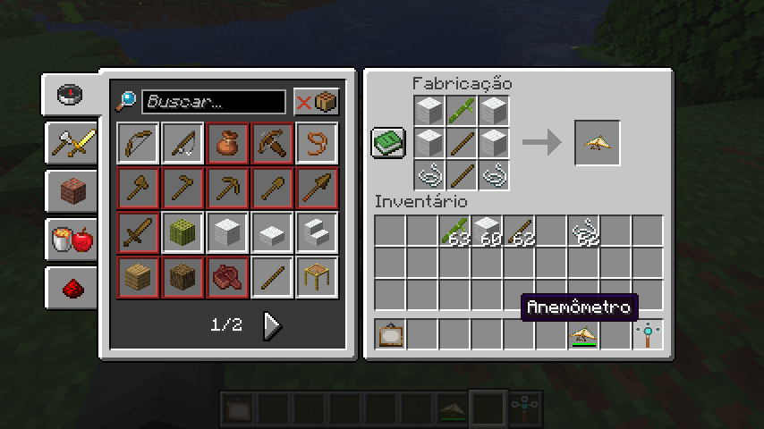
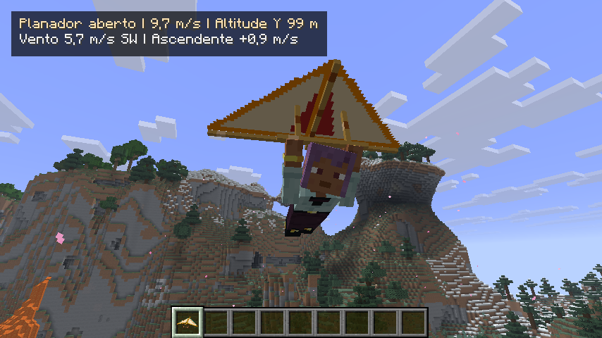

# Como craftar os itens do WindCraft BR

Receitas da versão **0.5.0**, conferidas nos arquivos de receita do mod.
Use uma **bancada de trabalho 3×3** e mantenha a disposição abaixo.

## Planador de Vento

| Lã | Bambu | Lã |
|---|---|---|
| Lã | Graveto | Lã |
| Linha | Graveto | Linha |

Materiais: **4 lãs de qualquer cor, 1 bambu, 2 gravetos e 2 linhas**.
Resultado: **1 Planador de Vento** (`windcraft:wind_glider`).

Captura enviada pelo autor: a bancada mostra os ingredientes e o Planador como resultado.

Segure em uma das mãos e use com o botão direito. Pode preparar no chão antes de
saltar ou ativar imediatamente no ar, sem precisar cair 1,5 bloco. A sustentação
depende da velocidade relativa do ar e do vento; preparar no chão não cria propulsão.

- **Mouse:** oriente o voo para onde estiver olhando; a curva é gradual.
- **W/S:** acelere perdendo altitude ou reduza a velocidade.
- **A/D:** complemente as curvas.
- **Espaço:** manobra breve de sustentação, quando houver velocidade suficiente.
- **Shift** ou usar novamente: feche o planador.
- **F5:** alterne a perspectiva como no jogo normal.

As teclas seguem as configurações do Minecraft. O item tem durabilidade.
Abrir perto demais do chão ou colidir em alta velocidade ainda pode causar dano.

## Anemômetro

| Vazio | Barra de ferro | Vazio |
|---|---|---|
| Barra de ferro | Bússola | Barra de ferro |
| Vazio | Graveto | Vazio |

Materiais: **3 barras de ferro, 1 bússola e 1 graveto**.
Resultado: **1 Anemômetro** (`windcraft:anemometer`).

Segure o instrumento e use com o botão direito para consultar a velocidade do
vento, a direção em graus/cardinal e a intensidade no local.

## Instalação

Requer Minecraft Java **26.3**, Forge **66.1.8** e Java **25**.
Coloque [windcraft-0.5.0.jar](../dist/windcraft-0.5.0.jar) na pasta `mods` da instância.
Remova versões antigas e use a mesma versão no cliente e no servidor.

Veja o [README](../README.md) para configuração, comandos e compilação.
